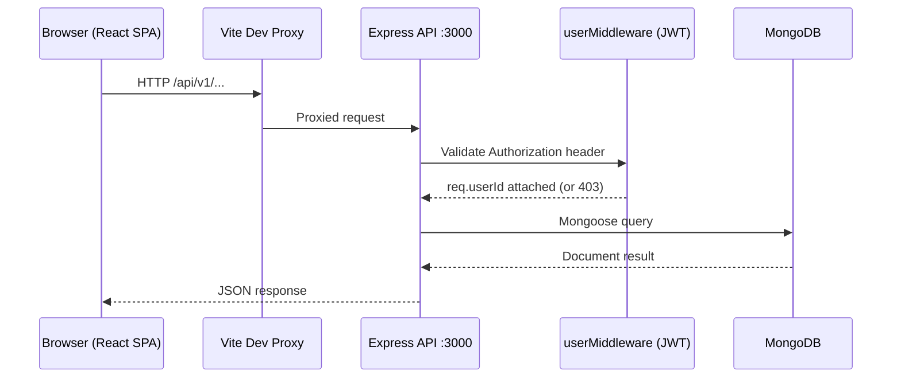

# Second Brain

> **A personal knowledge management platform** — save, organize, and revisit YouTube videos, Twitter/X posts, links, and documents in one structured workspace.

Second Brain solves a common problem for students, developers, and knowledge workers: valuable content gets bookmarked and immediately forgotten. This application gives you a single private workspace to capture any URL, tag it, categorize it, and find it again — with changes reflected in real time across all your sessions.

---

## Table of Contents

- [Overview](#overview)
- [Features](#features)
- [Technology Stack](#technology-stack)
- [Repository Structure](#repository-structure)
- [Prerequisites](#prerequisites)
- [Local Setup Guide](#local-setup-guide)
  - [Step A — Clone the Repository](#step-a--clone-the-repository)
  - [Step B — Install Dependencies](#step-b--install-dependencies)
  - [Step C — Configure Environment Variables](#step-c--configure-environment-variables)
  - [Step D — Start the Backend](#step-d--start-the-backend)
  - [Step E — Start the Frontend](#step-e--start-the-frontend)
  - [Step F — Verify the Application](#step-f--verify-the-application)
- [Environment Variable Reference](#environment-variable-reference)
- [Available Commands](#available-commands)
- [Architecture and API Reference](#architecture-and-api-reference)
- [Troubleshooting](#troubleshooting)
- [Roadmap](#roadmap)
- [Security Notes](#security-notes)
- [Contributing](#contributing)
- [Contribution Standards](#contribution-standards)
- [License](#license)
- [Author](#author)

---

## Overview

Second Brain is a full-stack TypeScript application built with React on the frontend and Express on the backend, backed by MongoDB. Users register with an email address, save content items (YouTube embeds, Twitter/X posts, links, and documents), and manage them through a responsive dashboard with a collapsible sidebar.

All content operations (create, read, update, delete) are backed by a REST API and reflected immediately on the client through optimistic UI updates and a 5-second background polling interval. A brain-sharing feature lets users generate a public read-only link to share their entire collection.

**Current status:** Active development. Core knowledge management and real-time sync are fully implemented. Planned improvements are listed in the [Roadmap](#roadmap).

---

## Features

### Knowledge and Note Management

- Save content items with a **title**, **URL**, **type**, and optional comma-separated **tags**
- Supported types: **YouTube**, **Twitter/X**, **Document**, **Link**
- Inline **YouTube video embeds** via the standard `<iframe>` embed API
- Native **Twitter/X post embeds** rendered via Twitter's `widgets.js`
- Document and link entries display the source URL with a clickable "Open" action
- **Edit** any saved item (title, link, type, tags) without deleting and re-adding it
- **Delete** any saved item with instant UI feedback

### Organization and Filtering

- **Sidebar navigation** filters content by type: All Notes, Twitter, YouTube, Documents, Links, Tags
- Live **item count badges** on each sidebar tab, updated as content changes
- Content type is **auto-selected** in the Add Content modal based on the active sidebar tab
- Tags displayed inline on each card as pill labels

### Frontend and User Experience

- **Responsive card grid**: 3 columns on desktop (`lg`), 2 on tablet (`md`), 1 on mobile
- **Fixed-height cards** (380 px) with smooth vertical scrolling for long content
- **Collapsible sidebar** with icon-only mode, smooth width transition, and content area shift (shadcn-style panel toggle)
- **Personalized greeting**: `Welcome back, {firstName}!` on the dashboard header
- Loading spinner during the initial content fetch
- Empty-state prompt with an inline **Add Content** button when no items exist

### Backend and API

- **Express 5** REST API with JSON body parsing and CORS enabled
- JWT-based route protection via an `Authorization` header (raw token or `Bearer <token>`)
- Full CRUD on `/api/v1/content` (create, list, update by ID, delete by ID)
- Brain sharing: generate or revoke a public share hash via `/api/v1/brain/share`
- Public read access to a shared brain at `/api/v1/brain/:shareLink`

### Authentication and Security

- Email-based registration (first name, last name, email, password)
- Passwords stored as plain text in the current build — **see [Security Notes](#security-notes)**
- JWT signed with a constant secret — **should be moved to an environment variable before deployment**
- Server-side `userId` isolation: users can only read or modify their own content

### Real-Time Sync

- `useContent` React hook polls the backend every **5 seconds**
- Hook also refreshes when the browser tab regains focus
- Optimistic updates: UI changes appear instantly; if the backend call fails, the hook re-fetches to restore accurate state

---

## Technology Stack

| Layer | Technology | Purpose |
|---|---|---|
| Frontend framework | React 19 | UI component model and state management |
| Frontend language | TypeScript 6 | Type safety across all components and hooks |
| Build tool | Vite 8 | Development server, hot module replacement, production bundler |
| Styling | Tailwind CSS 4 via `@tailwindcss/vite` | Utility-first CSS with custom theme tokens |
| Routing | React Router DOM 7 | Client-side routing and protected route guard |
| HTTP client | Axios 1 | REST API calls from the frontend |
| Backend framework | Express 5 | REST API server |
| Backend language | TypeScript 7 | Type-safe backend with ESM modules |
| Database | MongoDB (local instance) | Persistent storage for users, content, and share links |
| ODM | Mongoose 9 | Schema definitions, model queries, and document population |
| Authentication | jsonwebtoken 9 | Stateless JWT session tokens |
| CORS | cors 2 | Cross-origin request support for local development |

> No AI integrations or third-party analytics services are present in the current codebase.

---

## Repository Structure

```
second-brain/
├── LICENSE                          MIT License
├── .gitignore                       Excludes node_modules, dist, .env files
│
├── brainly-backend/                 Node.js + Express API server
│   ├── package.json                 Backend scripts and dependencies
│   ├── tsconfig.json                TypeScript config (ESNext, NodeNext modules)
│   └── src/
│       ├── config.ts                JWT secret constant  (move to .env)
│       ├── db.ts                    Mongoose connection and model definitions
│       ├── middleware.ts            JWT auth middleware (userMiddleware)
│       └── index.ts                All route handlers and server bootstrap
│
└── brainly-frontend/                React + Vite single-page application
    ├── package.json                 Frontend scripts and dependencies
    ├── vite.config.ts               Vite config: Tailwind plugin + /api proxy to :3000
    ├── tsconfig.json                TypeScript project references root
    ├── tsconfig.app.json            App-level TypeScript config
    ├── tsconfig.node.json           Node-level TypeScript config for Vite
    ├── eslint.config.js             ESLint configuration
    ├── index.html                   HTML entry point
    └── src/
        ├── main.tsx                 React app entry point
        ├── App.tsx                  Router setup and ProtectedRoute guard
        ├── config.ts                BACKEND_URL constant
        ├── index.css                Tailwind import, custom theme tokens, scrollbar CSS
        ├── pages/
        │   ├── Signup.tsx           Registration page (email, first/last name, password)
        │   ├── Signin.tsx           Sign-in page (email + password, stores JWT)
        │   └── Dashboard.tsx        Main workspace: grid, sidebar, modals, share brain
        ├── components/ui/
        │   ├── Button.tsx           Reusable button (primary/secondary, loading state)
        │   ├── Input.tsx            Reusable labeled input field
        │   ├── Card.tsx             Content card with YouTube/Twitter/Document/Link rendering
        │   ├── CreateContentModel.tsx   Modal for adding new content
        │   ├── EditContentModal.tsx     Modal for editing an existing card
        │   ├── Sidebar.tsx          Collapsible sidebar with navigation and user footer
        │   └── SidebarItem.tsx      Sidebar nav item with active state and count badge
        ├── hooks/
        │   └── useContent.tsx       Data hook: fetch, add, update, delete, polling, focus sync
        └── icons/                   SVG icon components (Brain, Twitter, YouTube, Link, Tag, etc.)
```

---

## Prerequisites

| Requirement | Minimum version | How to check |
|---|---|---|
| Node.js | 18 LTS or later | `node --version` |
| npm | 9 or later | `npm --version` |
| Git | Any recent version | `git --version` |
| MongoDB | 6 or later | `mongod --version` |

**MongoDB:** The backend connects to `mongodb://127.0.0.1:27017/second-brain` by default. MongoDB must be running locally before you start the backend. MongoDB Atlas is also supported — see [Step C](#step-c--configure-environment-variables).

> No `.nvmrc` or `engines` field is present in the repository. Node.js 18 LTS or later is recommended based on the ESNext module targets used by both packages.

---

## Local Setup Guide

### Step A — Clone the Repository

```bash
# Replace <your-username> with your GitHub username if working from a fork.
git clone https://github.com/<your-username>/second-brain.git
cd second-brain
```

### Step B — Install Dependencies

There are two separate Node.js applications. Each requires its own install.

**Backend:**
```bash
cd brainly-backend
npm install
```

**Frontend** (open a second terminal or go back to the root first):
```bash
cd brainly-frontend
npm install
```

> There is no root-level `package.json`. Do not run `npm install` in the repository root.

### Step C — Configure Environment Variables

#### Current state (development defaults — hardcoded)

The project does not yet use `.env` files. Three source files contain configuration values you may need to change:

| File | Current value | When to change |
|---|---|---|
| `brainly-backend/src/config.ts` | `JWT_Pass = "123123"` | Before sharing or deploying — use a strong secret |
| `brainly-backend/src/db.ts` | `mongodb://127.0.0.1:27017/second-brain` | When using MongoDB Atlas or a remote host |
| `brainly-frontend/src/config.ts` | `BACKEND_URL = "http://localhost:3000"` | When the backend runs on a different port or host |

#### Using MongoDB Atlas instead of a local instance

1. Create a free cluster at [cloud.mongodb.com](https://cloud.mongodb.com).
2. Create a database user under **Database Access** with a strong password.
3. Under **Network Access**, add your IP address (`0.0.0.0/0` is acceptable for local development only).
4. Click **Connect → Drivers** and copy the connection string:
   `mongodb+srv://<username>:<password>@cluster0.xxxxx.mongodb.net/second-brain`
5. Open `brainly-backend/src/db.ts` and replace the `mongoose.connect` argument:
   ```typescript
   mongoose.connect("mongodb+srv://<username>:<password>@cluster0.xxxxx.mongodb.net/second-brain")
   ```
6. **Never commit real credentials.** Move the URI to an environment variable before sharing or deploying the project.

#### Recommended next step: move secrets to `.env` files

Create `brainly-backend/.env` (never commit this file):
```
MONGO_URI=mongodb://127.0.0.1:27017/second-brain
JWT_SECRET=replace-with-a-strong-random-string-min-32-chars
PORT=3000
```

Then update `db.ts` and `config.ts` to read from `process.env`. Template files (`brainly-backend/.env.example`) are provided to guide contributors.

### Step D — Start the Backend

```bash
cd brainly-backend
npm run dev
```

Expected output:
```
Server is running on port 3000
Connected to MongoDB
```

> `npm run dev` compiles TypeScript first (`tsc -b`) and then runs the compiled output (`node dist/index.js`). It is **not** a watch-mode server — re-run the command after changing backend source files.

### Step E — Start the Frontend

In a separate terminal:
```bash
cd brainly-frontend
npm run dev
```

Expected output:
```
  VITE v8.x.x  ready in xxx ms

  Local:   http://localhost:5173/
```

Open [http://localhost:5173](http://localhost:5173) in your browser.

The Vite dev server proxies all `/api` requests to `http://localhost:3000`, so both services run on different ports without CORS friction during development.

### Step F — Verify the Application

After both servers are running, work through this checklist:

- [ ] Frontend loads at `http://localhost:5173`
- [ ] Backend console shows `Connected to MongoDB`
- [ ] `curl http://localhost:3000/api/v1/content` returns a `403` JSON response (expected — route is protected)
- [ ] Navigate to `/signup`, fill in first name, email, and password — you are redirected to `/signin`
- [ ] Sign in with the same credentials — you reach `/dashboard` with a personalized greeting
- [ ] Click **Add Content**, fill in a title and a URL, and submit — the card appears immediately
- [ ] Refresh the page — the card still exists (persisted in MongoDB)
- [ ] Click the pencil icon on a card, change the title, and save — the card updates in place
- [ ] Click the trash icon — the card is removed from the UI and the database

---

## Environment Variable Reference

> The project currently uses hardcoded values in source files. The table below reflects the variables that **should** be introduced as a near-term security improvement.

| Variable | Application | Required | Purpose | Example |
|---|---|---|---|---|
| `MONGO_URI` | Backend | Yes | MongoDB connection string | `mongodb://127.0.0.1:27017/second-brain` |
| `JWT_SECRET` | Backend | Yes | Secret used to sign and verify JWTs | `a-long-random-string-min-32-chars` |
| `PORT` | Backend | No | Port the Express server listens on | `3000` |
| `VITE_BACKEND_URL` | Frontend | No | Backend origin when not using Vite proxy | `http://localhost:3000` |

`.env` and `.env.*` files are excluded by `.gitignore`. Keep `.env.example` files (without real values) in each package directory for contributor reference.

---

## Available Commands

### Backend — `brainly-backend/`

| Command | npm script | Description |
|---|---|---|
| `npm run build` | `tsc -b` | Compile TypeScript to `dist/` |
| `npm run start` | `node dist/index.js` | Run the compiled server |
| `npm run dev` | `npm run build && npm run start` | Build then start |

> Linting and automated tests are not configured in the backend. There are no `lint` or `test` scripts.

### Frontend — `brainly-frontend/`

| Command | npm script | Description |
|---|---|---|
| `npm run dev` | `vite` | Start the Vite dev server with HMR |
| `npm run build` | `tsc -b && vite build` | Type-check and produce a production bundle in `dist/` |
| `npm run preview` | `vite preview` | Serve the production bundle locally for inspection |
| `npm run lint` | `eslint .` | Run ESLint across all source files |

> Automated tests are not configured. There is no `test` script or test framework in either package.

---

## Architecture and API Reference

### Request Flow



### API Endpoints

All authenticated routes require an `Authorization` header containing the raw JWT or `Bearer <token>`.

| Method | Route | Auth | Purpose |
|---|---|---|---|
| `POST` | `/api/v1/signup` | Public | Register a new user |
| `POST` | `/api/v1/signin` | Public | Authenticate and receive a JWT |
| `POST` | `/api/v1/content` | Required | Create a content item |
| `GET` | `/api/v1/content` | Required | List all content for the signed-in user |
| `PUT` | `/api/v1/content` | Required | Update a content item (`contentId` in request body) |
| `DELETE` | `/api/v1/content` | Required | Delete a content item (`contentId` in request body) |
| `POST` | `/api/v1/brain/share` | Required | Generate (`share: true`) or revoke (`share: false`) a public hash |
| `GET` | `/api/v1/brain/:shareLink` | Public | Read another user's brain using a share hash |

### Sign-Up Example

**Request**
```http
POST /api/v1/signup
Content-Type: application/json

{
  "firstName": "Jane",
  "lastName": "Doe",
  "email": "jane@example.com",
  "password": "secret"
}
```

**Response 200**
```json
{
  "message": "User signed up successfully",
  "user": {
    "id": "664f...",
    "firstName": "Jane",
    "lastName": "Doe",
    "email": "jane@example.com"
  }
}
```

### Add Content Example

**Request**
```http
POST /api/v1/content
Authorization: <jwt-token>
Content-Type: application/json

{
  "title": "100 Days of Code",
  "link": "https://www.youtube.com/watch?v=example",
  "type": "YouTube",
  "tags": ["coding", "challenge"]
}
```

**Response 200**
```json
{
  "message": "Content added successfully",
  "content": {
    "_id": "665a...",
    "title": "100 Days of Code",
    "link": "https://www.youtube.com/watch?v=example",
    "type": "YouTube",
    "tags": ["coding", "challenge"],
    "userId": "664f..."
  }
}
```

### MongoDB Collections

| Collection | Key fields |
|---|---|
| `users` | `firstName`, `lastName`, `email` (unique, sparse), `username` (sparse), `password` |
| `contents` | `title` (required), `link` (required), `type` (default: "Link"), `tags[]`, `userId` (ref: User) |
| `links` | `hash` (required), `userId` (ref: User, unique — one share link per user) |

---

## Troubleshooting

**`Cannot find module './db.js'` when starting the backend**
TypeScript has not been compiled. Run `npm run build` first, or use `npm run dev` which runs the build step automatically.

**MongoDB `ECONNREFUSED` or `MongoServerError`**
Confirm MongoDB is running locally. On Windows, start the MongoDB service from Services or run `mongod` in a terminal. For Atlas, verify the connection string, database user credentials, and IP whitelist.

**`ERR_NETWORK` in the browser console**
The frontend cannot reach the backend. Verify the backend is running on port 3000.

**Signup returns `409 Conflict`**
An account already exists for that email address. Use a different email or sign in.

**Backend changes are not reflected after editing source files**
`npm run dev` does not watch for file changes. Stop the process, make your edits, and re-run `npm run dev`.

**Port 3000 or 5173 already in use**
```bash
# Windows
netstat -ano | findstr :3000
taskkill /PID <pid> /F

# macOS / Linux
lsof -i :3000
kill -9 <pid>
```

**ESLint errors on `npm run lint`**
The project uses `typescript-eslint` with `eslint-plugin-react-hooks` and `eslint-plugin-react-refresh`. Review the reported lines and fix the flagged issues.

**`.gitignore` appears corrupted with conflict markers**
The `.gitignore` file contains unresolved Git merge conflict markers (`<<<<<<< HEAD`, `=======`, `>>>>>>>`). Open the file, manually remove the conflict markers, and keep the correct content from both sides before committing.

---

## Roadmap

The following are **proposed future improvements**. None are implemented in the current codebase.

### Foundation
- [ ] Move `JWT_SECRET` and `MONGO_URI` out of source files and into environment variables
- [ ] Hash passwords with `bcrypt` or `argon2` before storing
- [ ] Add request validation with a schema library such as `zod`
- [ ] Set up a watch-mode backend dev server (`nodemon` or `ts-node-dev`)
- [ ] Write unit tests for API routes and the `useContent` hook
- [ ] Resolve merge conflict markers in `.gitignore`

### Knowledge Retrieval
- [ ] Full-text search across titles, links, and tags
- [ ] Advanced filtering: date range, multiple tags, combined type filters
- [ ] Import from browser bookmarks (HTML export format)
- [ ] Export entire brain as JSON or Markdown

### Rich Content
- [ ] Markdown or rich-text notes attached to any content item
- [ ] Drag-and-drop card reordering
- [ ] Collections or folders for grouping related items
- [ ] Backlinks between related cards

### AI Capabilities
- [ ] Semantic search using vector embeddings
- [ ] Chat with your saved notes (retrieval-augmented Q&A)
- [ ] Automatic tag suggestions based on URL content or title
- [ ] Note summarisation for documents and videos

### Productivity
- [ ] One-click browser extension for quick capture
- [ ] Weekly review reminders or digest emails
- [ ] Tasks linked to a knowledge item

### Scale and Reliability
- [ ] Pagination for large content collections
- [ ] Rate limiting on authentication and content endpoints
- [ ] MongoDB indexes on `userId` and `type` for query performance
- [ ] CI/CD pipeline with automated lint and type-check
- [ ] Proper React error boundary components

---

## Security Notes

The following security gaps exist in the current development implementation. Address them before sharing or deploying the application.

1. **Passwords are stored in plain text.** Use `bcrypt` or `argon2` to hash passwords on signup and verify them on signin.
2. **JWT secret is hardcoded** as `"123123"` in `brainly-backend/src/config.ts`. Replace it with a cryptographically random string (32+ characters) loaded from an environment variable.
3. **No rate limiting** is applied to authentication routes. Brute-force attempts against `/api/v1/signin` are unrestricted.
4. **No input validation library** is used. Mongoose enforces schema types, but arbitrary strings can be stored in `title`, `link`, and `tags`.
5. **CORS is fully open** (`app.use(cors())`). Restrict the allowed origin list before production deployment.
6. **Do not commit `.env` files.** The `.gitignore` excludes `.env` and `.env.*` while allowing `.env.example`.
7. **User data isolation is enforced server-side.** All content queries and mutations include `userId: req.userId`, preventing users from reading or modifying each other's content.

---

## Contributing

Contributions are welcome. Please read this section before opening a pull request.

### Workflow

1. **Check existing issues** for related bug reports or feature discussions.
2. **Open an issue first** for non-trivial changes to agree on approach before writing code.
3. **Fork** the repository to your own GitHub account.
4. **Clone your fork:**
   ```bash
   git clone https://github.com/<your-username>/second-brain.git
   cd second-brain
   ```
5. **Add upstream remote** to stay in sync:
   ```bash
   git remote add upstream https://github.com/<original-owner>/second-brain.git
   ```
6. **Create a focused branch** from `main`:
   ```bash
   git checkout -b fix/card-overflow-on-mobile
   ```
7. Install dependencies in both packages (see [Step B](#step-b--install-dependencies)).
8. Make small, focused, testable changes.
9. **Run checks** before committing:
   ```bash
   cd brainly-frontend && npm run lint
   cd brainly-backend && npm run build
   ```
10. **Commit** with a clear conventional message:
    ```
    fix: prevent card body overflowing fixed height container
    feat: hash passwords with bcrypt on signup
    docs: add troubleshooting entry for port conflicts
    ```
11. **Push** to your fork:
    ```bash
    git push origin fix/card-overflow-on-mobile
    ```
12. **Open a pull request** against the `main` branch, describing the problem, your solution, and how you tested it.

### Keeping your fork in sync

```bash
git fetch upstream
git checkout main
git merge upstream/main
git push origin main
```

### Contributions we welcome

- Bug fixes with a clear reproduction path
- UI and accessibility improvements
- Backend hardening (validation, error handling, security)
- Performance work (indexes, pagination, caching)
- Documentation corrections and improvements
- Test coverage for routes and hooks
- Any roadmap item marked `[ ]` in this document

---

## Contribution Standards

- Follow existing file and naming conventions (`PascalCase` for components, `camelCase` for hooks and utilities)
- Use TypeScript types — avoid `any` where a specific type can be defined
- Validate untrusted backend input before writing to the database
- Keep business logic out of route handlers where practical
- Return consistent error shapes and meaningful HTTP status codes
- Never hardcode secrets, tokens, or API keys in source files
- Do not commit `node_modules/`, `dist/`, `.env`, or editor configuration files
- Write tests for new behaviour when a test framework is configured
- Update documentation when commands, routes, or configuration changes
- Keep pull requests focused — one concern per PR

### Pull request checklist

```
- [ ] Follows existing project structure and naming conventions
- [ ] TypeScript types added or updated where applicable
- [ ] Backend input validated before database writes
- [ ] No credentials or secrets hardcoded
- [ ] npm run lint passes in the frontend
- [ ] npm run build passes in the backend
- [ ] Manual smoke-test: signup, signin, add content, edit, delete
- [ ] PR description explains the problem, solution, and testing approach
- [ ] Screenshots included for any UI changes
- [ ] README updated if commands, routes, or configuration changed
```

---

## License

This project is licensed under the **MIT License**.
See the [LICENSE](./LICENSE) file for the full terms.

Copyright &copy; 2026 Monu Yadav

---

## Author

**Monu Yadav**

- GitHub: [@monuyadav-in](https://github.com/monuydv108)
- LinkedIn: [Monu Yadav](https://www.linkedin.com/in/monuyadav1126/)
